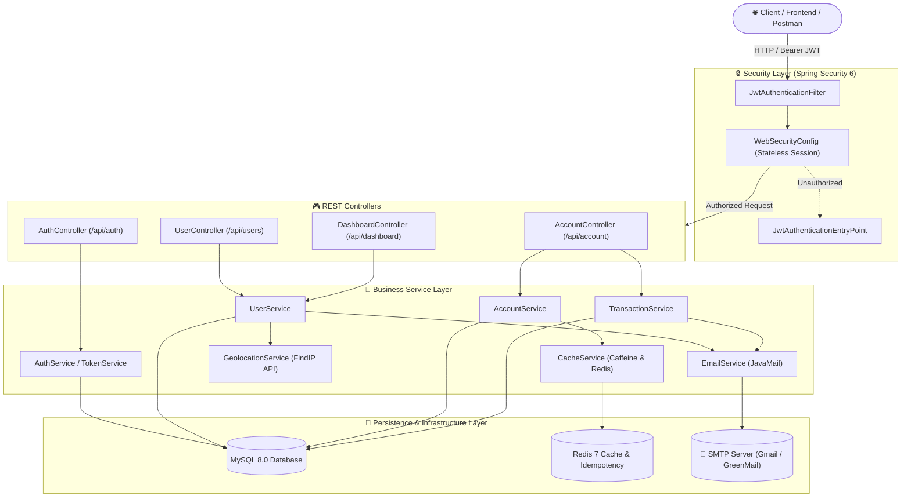

# 🏦 Banking Portal REST API

[](https://www.oracle.com/java/)
[](https://spring.io/projects/spring-boot)
[](https://spring.io/projects/spring-security)
[](https://www.mysql.com/)
[](https://redis.io/)
[](https://www.docker.com/)
[](http://localhost:8080/swagger-ui/index.html)

A secure, enterprise-grade **Banking Portal Backend API** engineered with **Spring Boot 3.3**, **Spring Security 6**, and **Java 17**. The platform delivers comprehensive retail banking features including automatic account creation, PIN-protected financial transactions, idempotency safeguards, Redis caching, OTP-driven password recovery, and email statement generation.

---

## 📑 Table of Contents

- [Key Features](#-key-features)
- [System Architecture](#-system-architecture)
- [Tech Stack](#-tech-stack)
- [Project Structure](#-project-structure)
- [API Reference](#-api-reference)
  - [Authentication & Password Reset](#1-authentication--password-reset-apiauth)
  - [User Management](#2-user-management-apiusers)
  - [Account & Core Banking Operations](#3-account--core-banking-operations-apiaccount)
  - [Dashboard Summary](#4-dashboard-apidashboard)
- [Getting Started](#-getting-started)
  - [Prerequisites](#prerequisites)
  - [1. Clone Repository](#1-clone-repository)
  - [2. Start Infrastructure with Docker](#2-start-infrastructure-with-docker)
  - [3. Configure Application Properties](#3-configure-application-properties)
  - [4. Build & Run Application](#4-build--run-application)
- [API Documentation (Swagger UI)](#-api-documentation-swagger-ui)
- [Postman Collection](#-postman-collection)
- [Testing & Quality Assurance](#-testing--quality-assurance)
- [Contributing](#-contributing)
- [License](#-license)

---

## 🌟 Key Features

- **🔐 Stateless JWT Authentication**:
  - Secure user onboarding, authentication, and token revocation via stateless Bearer tokens.
  - BCrypt cryptographic hashing for passwords and account transaction PINs.
- **💳 Core Banking Operations**:
  - **Account Auto-Provisioning**: Automatically generates a unique bank account upon registration.
  - **PIN Security**: Dedicated 4-digit transaction PIN required for sensitive operations (deposits, withdrawals, transfers).
  - **Instant Fund Transfers**: Atomic account-to-account funds routing with real-time balance validation and ledger entries.
  - **Cash Deposits & Withdrawals**: Flexible balance management with overdraft prevention.
- **⚡ High Performance & Idempotency**:
  - **Redis Idempotency Layer**: Financial endpoints (`/deposit`, `/withdraw`, `/fund-transfer`) enforce idempotency keys via Redis to prevent double debits or network duplicate execution.
  - **Multi-Level Caching**: Caffeine local memory cache alongside Redis distributed cache.
- **📧 Email Notifications & Bank Statements**:
  - Automated welcome emails on successful customer registration.
  - On-demand generation and HTML dispatch of full bank transaction statements directly to user inboxes.
- **🛡️ Two-Factor OTP & Recovery**:
  - Time-limited OTP generation and email dispatch for multi-factor logins and self-service password resets.
- **🌍 IP Geolocation Intelligence**:
  - Integrates client IP lookup to record and verify login geographical context.
- **📊 Interactive OpenAPI 3 / Swagger Docs**:
  - Fully annotated endpoints accessible via browser for live API testing.

---

## 🏗️ System Architecture



---

## 🧰 Tech Stack

| Component | Technology | Version | Purpose |
| :--- | :--- | :--- | :--- |
| **Language** | Java | `17 (LTS)` | Core runtime |
| **Framework** | Spring Boot | `3.3.1` | Application scaffolding and DI container |
| **Security** | Spring Security & JJWT | `6.x` / `0.11.5` | Stateless authentication, authorization & filters |
| **Database** | MySQL | `8.0` | Primary relational transactional data store |
| **Persistence** | Spring Data JPA / Hibernate | `6.x` | ORM entities and database repositories |
| **Caching** | Redis & Caffeine | `7-alpine` / `3.x` | Distributed idempotency locking and local caching |
| **Mailing** | Spring Mail & GreenMail | `3.3.1` / `2.0` | SMTP email dispatch and testing |
| **Documentation** | Springdoc OpenAPI | `2.0.2` | Interactive Swagger UI API specs |
| **Validation** | Jakarta Bean Validation & Libphonenumber | `3.0` / `8.13.x` | Payload formatting and phone verification |
| **Orchestration**| Docker & Docker Compose | `3.8 spec` | Containerized database and cache services |
| **Testing** | JUnit 5, MockMvc, JavaFaker | `5.10` / `1.0.2` | Automated unit, integration, and mocking tests |

---

## 📂 Project Structure

```text
BankingPortal-API/
├── .github/                     # Issue templates and workflows
├── docker/
│   └── docker-compose.yml       # MySQL 8 & Redis 7 services configuration
├── src/
│   ├── main/
│   │   ├── java/com/webapp/bankingportal/
│   │   │   ├── BankingportalApplication.java   # Spring Boot entry point
│   │   │   ├── config/                         # Security, Redis, Cache, Swagger & CORS config
│   │   │   ├── controller/                     # REST API controllers & global exception handler
│   │   │   ├── dto/                            # Request & response data transfer objects
│   │   │   ├── entity/                         # JPA domain entities (User, Account, Transaction, etc.)
│   │   │   ├── exception/                      # Custom business exception definitions
│   │   │   ├── mapper/                         # MapStruct model-to-DTO mappers
│   │   │   ├── repository/                     # Spring Data JPA repositories
│   │   │   ├── security/                       # JWT entry point and token filter
│   │   │   ├── service/                        # Service interfaces & implementations
│   │   │   └── util/                           # Helper utilities (API messages, JSON, Context)
│   │   └── resources/
│   │       ├── application.properties.sample   # Environment configuration template
│   │       └── logback-spring.xml              # Structured logging configuration
│   └── test/java/com/webapp/bankingportal/     # Controller & service test suites
├── Banking Portal.postman_collection.json      # Postman API test collection
├── Dockerfile                                  # Multi-stage production container image
├── pom.xml                                     # Maven project build descriptor
└── README.md                                   # Project documentation
```

---

## 🔌 API Reference

### 1. Authentication & Password Reset (`/api/auth`)

| Method | Endpoint | Description | Auth Required |
| :--- | :--- | :--- | :---: |
| `POST` | `/api/auth/password-reset/send-otp` | Sends a 6-digit password reset OTP to user email | No |
| `POST` | `/api/auth/password-reset/verify-otp` | Verifies OTP and returns a temporary password reset token | No |
| `POST` | `/api/auth/password-reset` | Resets user password using the verified reset token | No |

---

### 2. User Management (`/api/users`)

| Method | Endpoint | Description | Auth Required |
| :--- | :--- | :--- | :---: |
| `POST` | `/api/users/register` | Registers a new user, creates bank account, and sends welcome email | No |
| `POST` | `/api/users/login` | Authenticates user credentials and returns JWT Bearer token | No |
| `POST` | `/api/users/generate-otp` | Generates login OTP for two-factor verification | No |
| `POST` | `/api/users/verify-otp` | Validates OTP and completes two-factor login | No |
| `POST` | `/api/users/update` | Updates user profile details (name, email, address, phone) | **Yes (Bearer)** |
| `GET` | `/api/users/logout` | Revokes the current JWT token and logs user out | **Yes (Bearer)** |

---

### 3. Account & Core Banking Operations (`/api/account`)

*All account endpoints require an `Authorization: Bearer <token>` header.*

| Method | Endpoint | Description | Idempotency |
| :--- | :--- | :--- | :---: |
| `GET` | `/api/account/pin/check` | Checks if account has set up a 4-digit transaction PIN | — |
| `POST` | `/api/account/pin/create` | Creates initial 4-digit transaction PIN with password confirmation | Cached |
| `POST` | `/api/account/pin/update` | Updates transaction PIN (verifies old PIN and password) | Cached |
| `POST` | `/api/account/deposit` | Deposits cash into logged-in user account | **Protected** |
| `POST` | `/api/account/withdraw` | Withdraws funds with PIN validation and balance check | **Protected** |
| `POST` | `/api/account/fund-transfer` | Transfers money to target account number with PIN validation | **Protected** |
| `GET` | `/api/account/transactions` | Retrieves comprehensive ledger transaction history | — |
| `GET` | `/api/account/send-statement` | Compiles bank statement and dispatches via email | — |

---

### 4. Dashboard (`/api/dashboard`)

*Requires `Authorization: Bearer <token>` header.*

| Method | Endpoint | Description |
| :--- | :--- | :--- |
| `GET` | `/api/dashboard/user` | Fetches logged-in user profile attributes |
| `GET` | `/api/dashboard/account` | Fetches account details, balance, and account number |

---

## 🚀 Getting Started

### Prerequisites

- **Java Development Kit (JDK)**: Version `17` or higher
- **Maven**: Version `3.8+` (or use bundled `./mvnw`)
- **Docker & Docker Compose**: To run MySQL 8 and Redis 7 containers

---

### 1. Clone Repository

```bash
git clone https://github.com/ParthThakkarR/BankingPortal-API.git
cd BankingPortal-API
```

---

### 2. Start Infrastructure with Docker

Launch MySQL 8.0 and Redis 7 using Docker Compose:

```bash
docker compose -f docker/docker-compose.yml up -d
```

Verify that the containers are healthy and running:

```bash
docker ps
```

- **MySQL Port**: `3306` (`bankingapp` database, user: `bankinguser`, password: `bankingpass`)
- **Redis Port**: `6379`

---

### 3. Configure Application Properties

Copy the template configuration into `src/main/resources/application.properties`:

```bash
cp src/main/resources/application.properties.sample src/main/resources/application.properties
```

Update your configuration parameters as needed:

```properties
# Server Port
server.port=8080

# MySQL DataSource
spring.datasource.url=jdbc:mysql://localhost:3306/bankingapp?createDatabaseIfNotExist=true
spring.datasource.username=bankinguser
spring.datasource.password=bankingpass
spring.datasource.driver-class-name=com.mysql.cj.jdbc.Driver

# JPA / Hibernate
spring.jpa.hibernate.ddl-auto=update
spring.jpa.database-platform=org.hibernate.dialect.MySQLDialect

# JWT Configuration
jwt.secret=bXlTdXBlclNlY3JldEtleUZvckJhbmtpbmdQb3J0YWxBUEkyMDI0IQ==
jwt.expiration=86400000

# Redis Cache
spring.data.redis.host=localhost
spring.data.redis.port=6379

# Spring Mail (Gmail SMTP or Mailtrap)
spring.mail.host=smtp.gmail.com
spring.mail.port=587
spring.mail.username=your-email@gmail.com
spring.mail.password=your-app-password
spring.mail.properties.mail.smtp.auth=true
spring.mail.properties.mail.smtp.starttls.enable=true
```

---

### 4. Build & Run Application

Run the Spring Boot application using the Maven wrapper:

```bash
# Windows
.\mvnw.cmd spring-boot:run

# Linux / macOS
./mvnw spring-boot:run
```

The API will initialize and bind to: `http://localhost:8080` (or your configured `server.port`).

---

## 📖 API Documentation (Swagger UI)

Once the application is running, explore and interact with all endpoints directly through the browser:

- **Swagger UI**: [http://localhost:8080/swagger-ui/index.html](http://localhost:8080/swagger-ui/index.html)
- **OpenAPI 3 JSON Specification**: [http://localhost:8080/v3/api-docs](http://localhost:8080/v3/api-docs)

---

## 📬 Postman Collection

A preconfigured Postman collection is included in the project root:
- [`Banking Portal.postman_collection.json`](./Banking%20Portal.postman_collection.json)

**How to use**:
1. Open **Postman** and click **Import**.
2. Select `Banking Portal.postman_collection.json`.
3. Set up the collection environment variable `baseUrl` to `http://localhost:8080`.
4. Register a user, copy the received token from `/api/users/login`, and paste it into the `Authorization` header for protected endpoints.

---

## 🧪 Testing & Quality Assurance

The repository includes comprehensive tests across controllers, services, token handling, and caching:

```bash
# Execute test suite
./mvnw clean test
```

- **MockMvc**: Validates HTTP status codes, headers, and payload structures.
- **GreenMail**: Embedded in-memory SMTP server to verify mail dispatch in tests without real email traffic.
- **JavaFaker**: Generates dynamic and realistic test payloads.

---

## 🤝 Contributing

Contributions are welcome! To contribute:

1. Fork the Project (`https://github.com/ParthThakkarR/BankingPortal-API/fork`)
2. Create your Feature Branch (`git checkout -b feature/NewFeature`)
3. Commit your Changes (`git commit -m "feat: Add NewFeature"`)
4. Push to the Branch (`git push origin feature/NewFeature`)
5. Open a Pull Request

---

## 📄 License

This project is licensed under the [MIT License](LICENSE).
